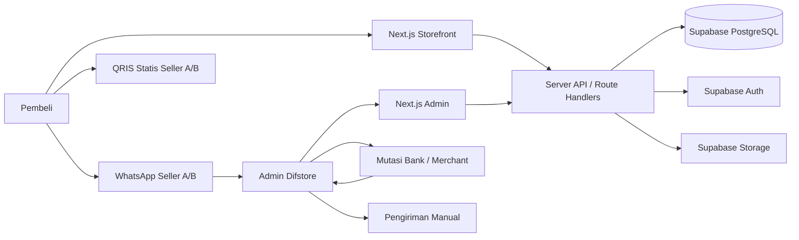

# PRODUCT REQUIREMENTS DOCUMENT (PRD)
# DIFSTORE — Digital Product Commerce Platform

**Versi:** 1.0 — Baseline implementasi, amendment ADM-01  
**Tanggal:** 12 Oktober 2026  
**Status:** Ready for engineering discovery and implementation, dengan release gate infrastruktur  
**Pemilik produk:** Pengelola Difstore  
**Target pembaca:** Product owner, AI coding agent, full-stack developer, UI/UX designer, QA  
**Bahasa aplikasi:** Indonesia; mata uang IDR; zona waktu bisnis Asia/Jakarta  
**Tipe produk:** E-commerce satu toko, satu admin, dua seller penerima pembayaran, transaksi QRIS statis + WhatsApp manual

> Dokumen ini adalah sumber kebenaran untuk implementasi. Semua bagian bertanda **[KEPUTUSAN PENGGUNA]** berasal dari jawaban pemilik proyek. Bagian **[ASUMSI / REKOMENDASI]** merupakan keputusan sementara yang dapat diubah di dashboard atau konfigurasi tanpa mengubah konsep inti.

---

## 0. Ringkasan keputusan dan asumsi

### 0.1 Keputusan yang sudah pasti

| Aspek | Keputusan |
|---|---|
| Nama brand | **Difstore** |
| Model | Satu brand, satu storefront, dikelola dua orang |
| Admin | Satu akun admin full access; kredensial tidak dibagikan |
| Pengunjung | Publik; pembeli **tidak** harus mendaftar atau login |
| Barang | PDF, template Canva, Notion, Excel, Figma, dan PowerPoint |
| UI | E-commerce modern: hero, kategori, product grid |
| Pembelian | Keranjang mendukung beberapa produk |
| Pembayaran | QRIS **statis**; rekening/QRIS tujuan mengikuti pemilik produk |
| WhatsApp | Kontak WhatsApp dilakukan **sebelum pembayaran** |
| Bukti pembayaran | Pembeli mengirim screenshot melalui WhatsApp |
| Verifikasi | Admin memeriksa pembayaran **secara manual** |
| Fulfillment | Admin mengirim tautan/file **secara manual** |
| Nomor kontak | Berbeda menurut pemilik produk / admin penanganan |
| Teknologi | Next.js, TypeScript, Tailwind CSS, Supabase |
| Preferensi hosting | Vercel, tetapi harus memenuhi anggaran dan ketentuan komersial |
| Anggaran | Rp0 operasional sebisa mungkin, biaya domain boleh |
| Target cakupan | Versi lengkap v1 sejak peluncuran; dikerjakan bertahap |
| Visual | Monokrom hitam, putih, abu-abu, dengan aksen berbasis psikologi warna |

### 0.2 Asumsi yang diputuskan untuk menghindari ambiguitas

| ID | Asumsi / rekomendasi | Alasan |
|---|---|---|
| AS-01 | Target utama Indonesia, harga IDR, konten bahasa Indonesia | Sesuai QRIS dan WhatsApp |
| AS-02 | Tepat satu akun admin diprovisi manual untuk v1; tidak ada pendaftaran admin publik atau shared credential. Penambahan admin memerlukan keputusan produk eksplisit | Keamanan dan keputusan pemilik |
| AS-03 | Tiap produk memiliki **tepat satu** pemilik penerima pembayaran (`seller_id`) | Attribution pembayaran dan pelaporan jelas |
| AS-04 | Produk dalam satu keranjang boleh berasal dari dua pemilik; saat checkout sistem menghasilkan **satu checkout group dan satu order per pemilik** | Satu QRIS statis tidak otomatis membagi pembayaran |
| AS-05 | Buyer name + WhatsApp wajib; email opsional; tidak menyimpan alamat fisik | Guest checkout rendah friksi |
| AS-06 | Variasi paket produk didukung, tetapi tiap variasi memiliki harga sendiri dan tetap mengikuti pemilik produk yang sama | Katalog fleksibel |
| AS-07 | Keranjang disimpan di localStorage; rincian produk/harga selalu diperiksa ulang di server saat checkout | Tidak perlu login tanpa memercayai harga client |
| AS-08 | Status pembayaran dan fulfillment diubah **oleh admin**; klik WhatsApp atau tombol “sudah bayar” tidak menjadikan pesanan `paid` | Hindari klaim palsu |
| AS-09 | Pembeli bisa melihat status menggunakan tautan token acak, tanpa akun; tidak boleh mengakses pesanan orang lain | Guest order tracking aman |
| AS-10 | Storage privat hanya untuk file/aset internal; buyer menerima produk melalui WhatsApp dari admin, bukan unduhan terbuka otomatis | Sesuai fulfillment manual |
| AS-11 | Diskon harga coret, kupon per pemilik, bundle per pemilik, produk unggulan, FAQ, testimoni terverifikasi, analitik dasar termasuk v1 | Mendukung konversi tanpa overengineering pembayaran |
| AS-12 | Dashboard revenue per pemilik dan gabungan; tidak ada bagi hasil otomatis | Uang diterima langsung oleh masing-masing pemilik |
| AS-13 | Tidak ada pajak, biaya layanan, atau shipping tambahan kecuali ditampilkan secara jelas dan disetujui sebelum checkout | Produk digital; hindari biaya tersembunyi |
| AS-14 | Bahasa visual dominan light mode, dengan footer gelap dan aksen biru kepercayaan; dark mode opsional, bukan syarat rilis | Memaksimalkan keterbacaan katalog |
| AS-15 | Target performa/konversi adalah hipotesis awal, bukan fakta/hasil yang dijamin | Belum ada baseline traffic |
| AS-16 | Website dapat digunakan pada hosting yang sesuai penggunaan komersial; opsi tanpa biaya akan diuji sebelum diputuskan final | Vercel Hobby tidak diperbolehkan untuk situs komersial |

### 0.3 Hal yang belum diketahui — tidak memblokir pembangunan

Domain final, logo, nomor WA, QRIS dua pemilik, nama legal/identitas merchant, kebijakan refund final, konten produk, testimoni asli, harga riil, serta aset gambar belum tersedia. Semuanya harus menjadi **data konfigurasi**, bukan di-hardcode. Gunakan data demo realistis yang diberi label `DEMO` pada environment pengembangan; hapus atau ganti sebelum produksi. Jangan membuat testimoni palsu untuk situs live.

---

## 1. Product vision dan konteks bisnis

### 1.1 Latar belakang

Penjual produk digital sering mengandalkan chat manual untuk menjelaskan produk, harga, menerima pembayaran, dan mengirim file. Cara ini mudah dimulai, tetapi menimbulkan masalah: katalog tidak konsisten, calon pembeli perlu bertanya berulang, pesanan sulit dilacak, perbedaan QRIS pemilik rawan tertukar, dan data penjualan tidak terdokumentasi. Difstore memusatkan etalase, detail produk, keranjang, pencatatan pesanan, serta koordinasi WhatsApp ke dalam satu website.

### 1.2 Visi

Menjadi toko produk digital yang mudah dijelajahi, dipercaya, dan nyaman digunakan dari ponsel; menggabungkan pengalaman belanja e-commerce modern dengan fleksibilitas pelayanan manual berbasis WhatsApp.

### 1.3 Nilai bagi pembeli

- Dapat mengevaluasi produk, melihat preview, fitur, format file, kompatibilitas, lisensi, dan harga sebelum chat.
- Dapat membeli beberapa barang dalam satu sesi tanpa registrasi.
- Mendapat rincian dan ID pemesanan yang jelas.
- Dapat berkomunikasi langsung dengan pemilik produk yang benar.
- Mengetahui metode bayar, instruksi konfirmasi, estimasi pemrosesan yang diumumkan, dan status yang tidak menyesatkan.

### 1.4 Nilai bagi pengelola

- Satu dashboard bersama untuk mengelola katalog, harga, promo, konten, transaksi, dan kinerja.
- Setiap produk dikaitkan dengan pemilik penerima pembayaran.
- Rekap pesanan dan omzet per pemilik serta seluruh toko.
- Riwayat perubahan status, audit tindakan admin, dan pengurangan kesalahan operasional.
- SEO dan struktur katalog untuk memperoleh pengunjung dari pencarian serta media sosial.

### 1.5 Tujuan utama dan indikator

| Tujuan | Metrik | Definisi / target awal yang perlu divalidasi |
|---|---|---|
| Katalog mudah dipahami | Product detail view rate | Product detail views / catalog sessions; observasi awal |
| Mendorong minat beli | Add-to-cart rate | Sessions with add-to-cart / store sessions |
| Memudahkan checkout | Checkout creation rate | Created checkout groups / sessions with cart |
| Mengarahkan transaksi | WhatsApp intent rate | Order yang CTA WA-nya dibuka / orders created; **bukan** chat terkirim |
| Mengukur penjualan aktual | Verified paid orders | Jumlah `paid` yang diverifikasi admin |
| Mengevaluasi kualitas proses | Fulfillment time | Waktu `paid_at` → `fulfilled_at` |
| Menghindari pembayaran salah pemilik | Owner-routing mismatch | Target 0 kasus akibat kesalahan kode |
| Mengurangi error transaksi | Invalid price/order incidents | Target 0 kasus di produksi |
| Kesiapan mobile | Mobile checkout success | Seluruh skenario utama lulus di layar kecil |
| Kinerja | Core Web Vitals | LCP p75 ≤2,5 dtk; INP p75 ≤200 ms; CLS p75 ≤0,1 sebagai target, bukan jaminan |

Metrik yang bergantung pada traffic diperlakukan sebagai baseline yang dikumpulkan sesudah rilis. Jangan mengarang angka sukses atau testimoni.

### 1.6 Persona

**P1 — Pembeli mobile dari media sosial:** mengunjungi tautan dari TikTok/Instagram/WhatsApp, cepat membandingkan produk, tidak ingin login, meminta bukti/preview, memilih WA untuk tanya/pesan.

**P2 — Pembeli dari Google:** menemukan detail produk melalui mesin pencari, membaca fitur/FAQ/lisensi, ingin kepastian kompatibilitas, harga dan instruksi pembelian.

**P3 — Admin Difstore:** menambahkan produk, mengubah konten, memeriksa pesanan, memeriksa mutasi QRIS seller yang relevan, mengirim file, mengubah status, dan meninjau pendapatan.

---

## 2. Scope, prioritas, dan batas produk

### 2.1 Harus tersedia pada rilis v1 (P0)

1. Storefront: homepage, kategori, katalog, detail, pencarian, filter, urutkan, rekomendasi produk, FAQ, kontak, About, kebijakan.
2. Keranjang persistent tanpa login; variasi produk; Buy Now dan Add to Cart; ubah/hapus item.
3. Checkout guest dengan validasi; harga dihitung ulang server; checkout lintas pemilik dipisah otomatis.
4. Satu order per pemilik dalam satu checkout group; WA CTA berbeda; QRIS berbeda; instruksi pembayaran jelas.
5. Status pesanan melalui token rahasia; catatan aktivitas; alur verifikasi pembayaran & pengiriman manual.
6. Admin auth, satu akun full access, dashboard, CRUD produk/kategori/media/variasi, status, promo, pesanan, pengaturan seller dan toko.
7. Statistik transaksi dasar, laporan per seller, ekspor CSV, audit log.
8. SEO teknis, metadata per produk, sitemap, robots, Open Graph, skema structured data yang akurat.
9. UI responsive, aksesibilitas dasar, error/empty/loading states, keamanan dan pengujian.
10. Halaman legal minimal yang isinya disetujui pemilik, bukan otomatis mengklaim kepatuhan.

### 2.2 Fitur P1 — target kelengkapan v1, setelah alur P0 stabil

- Kupon diskon per pemilik dengan masa berlaku, batas pakai, minimal belanja dan rekap penukaran.
- Bundle produk dari pemilik yang sama (harga terpisah dan entitlement/asset per isi bundle).
- Featured products, hero/content blocks yang dapat diedit, promo banner, kategori populer.
- Testimoni asli (ditambahkan admin setelah bukti izin), status publish/unpublish.
- Event funnel agregat dan campaign UTM, landing page kampanye yang reusable.
- Draft dan preview konten produk; soft delete/archive dan restore.

### 2.3 Di luar scope v1 (future; jangan dibuat seolah sudah bekerja)

Payment gateway otomatis, webhook konfirmasi pembayaran, transfer/pembagian hasil otomatis, login pembeli, delivery otomatis, WhatsApp Business API berbayar, live chat bot, marketplace penjual pihak ketiga, multi-tenant storefront, subscription/membership, affiliate payout, pengelolaan pajak otomatis, invoice pajak resmi, layanan pengembalian uang otomatis, sinkronisasi mutasi bank, aplikasi mobile native, marketplace eksternal.

**Aturan prioritas:** “Lengkap sejak awal” berarti target rilis v1 mencakup P0 **dan** kemampuan P1 yang tercantum, setelah alur utama end-to-end stabil. Jangan menunda pengujian dan keamanan demi kosmetik. Apabila ada fitur P1 belum selesai, agent wajib melaporkan gap secara eksplisit; rilis dengan gap memerlukan keputusan sadar pemilik proyek, bukan klaim v1 sudah lengkap.

---

## 3. Model domain dan aturan bisnis

### 3.1 Domain penting

- **Store:** Difstore, satu identitas brand dan katalog publik.
- **Seller:** pemilik penerima uang (A/B); tidak berarti merchant pihak ketiga.
- **Admin:** pengguna yang boleh login dashboard; keduanya full access. Seller dan admin tidak harus direpresentasikan sebagai relasi 1:1 secara permanen, namun awalnya satu seller memiliki admin penanggung jawab.
- **Product:** produk digital milik satu seller, berisi informasi produk dan variasi.
- **Variant:** paket/opsi harga dari product; contoh Single, Bundle, Premium.
- **CheckoutGroup:** satu sesi checkout pembeli untuk beberapa produk, bisa menghasilkan beberapa order.
- **Order:** satu instruksi bayar yang hanya memiliki **satu** seller dan satu QRIS/payment account.
- **OrderItem:** item produk/variasi beserta snapshot nama, harga, diskon, qty dan lisensi pada waktu transaksi.
- **PaymentAccount:** QRIS merchant milik seller beserta gambar pembayaran, nama penerima, status aktif.
- **Fulfillment:** pemenuhan manual yang dicatat admin setelah diverifikasi.

### 3.2 Business invariants (wajib dijaga hingga lapisan database)

1. Setiap produk dan order memiliki satu `seller_id` yang valid.
2. Seluruh `order_items` dalam satu order harus milik seller yang sama dengan `orders.seller_id` — dibuktikan validasi transaksi server dan invariant database bila memungkinkan.
3. Hanya item aktif, published, purchasable dan varian tersedia yang dapat dipesan.
4. Harga, pemilik, diskon dan total dihitung ulang di server; **tidak pernah** memakai harga dari browser sebagai sumber kebenaran.
5. Setelah order dibuat, `order_items`, mata uang, harga dan payment account bersifat **snapshot**; mengubah produk atau QRIS aktif tidak mengubah order lama.
6. Satu checkout group dengan item multi-seller menghasilkan satu order untuk setiap seller; pesan WhatsApp dan QRIS **terpisah**.
7. QRIS statis tidak menjamin nominal sudah benar dan tidak mengkonfirmasi pembayaran; website tidak boleh otomatis mengubah status menjadi `paid`.
8. Pengiriman produk hanya boleh ditandai selesai oleh admin ketika pembayaran sudah diverifikasi (`paid`) atau untuk produk gratis yang memiliki jalur khusus.
9. Admin full access boleh melihat seluruh transaksi; semua perubahan sensitif dicatat di audit log dengan actor ID.
10. Tautan status order tanpa login menggunakan token rahasia berentropi tinggi, tidak menampilkan data sensitif seller/buyer lain, dan tidak dapat melakukan perubahan status.
11. Kupon dan bundle harus memiliki aturan seller dan perhitungan harga yang konsisten, tidak membagi potongan lintas seller secara ambigu.
12. Semua nominal disimpan sebagai integer rupiah (`bigint` atau integer aman), tidak menggunakan floating point.

### 3.3 Contoh checkout campuran

- Keranjang: **Produk PDF A** Rp25.000 (seller A), **Template Notion B** Rp40.000 (seller B), **Template PPT C** Rp15.000 (seller A).
- Checkout group memiliki total tampilan **Rp80.000**, tetapi ini **bukan** satu tagihan QRIS.
- Order A: PDF A + PPT C = **Rp40.000**, tujuan QRIS A, pesan WA A.
- Order B: Notion B = **Rp40.000**, tujuan QRIS B, pesan WA B.
- Halaman hasil checkout menampilkan dua kartu “Bayar ke Admin A” dan “Bayar ke Admin B”, masing-masing dengan nomor order unik, QRIS yang tepat, nominal dan WhatsApp yang tepat.
- Label: **“Total seluruh pesanan Rp80.000 — lakukan 2 pembayaran terpisah.”**
- Jika salah satu order dibatalkan, order lainnya tetap valid. Dashboard dan laporan tidak menghitung dua kali total checkout group.

### 3.4 Kuantitas dan variasi

Produk digital default quantity 1; item yang identik dalam keranjang tidak digandakan (meningkatkan quantity hanya jika secara eksplisit diizinkan oleh aturan lisensi). Variant berbeda dari produk yang sama dapat menjadi item terpisah. Bundling tetap hanya dari satu seller. Harga coret adalah referensi historis yang valid, bukan fabricated urgency.

### 3.5 Promo dan kalkulasi

Prioritas: harga dasar varian → harga promo produk (jika aktif) → diskon kupon seller (jika valid) → total order. Diskon tidak boleh menghasilkan nilai negatif; pembulatan pada tingkat item/order didefinisikan eksplisit dan diuji. Kupon seller A tidak boleh mengubah order seller B. Tidak menambahkan biaya admin tanpa konfigurasi transparan; nilai default 0.

---

## 4. Pengalaman pembeli — user journey rinci

### 4.1 Browse dan evaluasi

`Media sosial / Google / direct → Home atau Product Detail → Browse/search/filter → Lihat preview, fitur, lisensi, harga → Tambah keranjang/Buy Now`.

- Cart icon menampilkan jumlah varian unik; toast setelah add-to-cart menyediakan “Lihat Keranjang” dan “Lanjut Belanja”.
- Jika produk tidak aktif/diarsipkan, tidak ditampilkan untuk pembelian. URL lama memperlihatkan state “tidak tersedia” atau 404 yang dipilih konsisten; tetap menghindari expose produk tersembunyi.
- Preview bisa berupa gambar dokumen/templat atau link demo publik yang berbeda dari file berbayar.

### 4.2 Checkout guest

1. Pembeli membuka cart; server memvalidasi setiap produk/varian dan menampilkan pembaruan harga jika berubah.
2. Pembeli mengisi **nama** dan **nomor WhatsApp** (wajib), **email** (opsional), **catatan** (opsional).
3. Checkbox persetujuan kebijakan diperlukan sesuai rancangan legal; consent marketing **terpisah, tidak dicentang otomatis**.
4. Website menunjukkan ringkasan subtotal dan total **per seller**, plus berapa pembayaran yang diperlukan.
5. Klik “Buat Pesanan” mengirim data berupa ID produk/variant/quantity + data checkout; server membuat group & orders secara atomik serta mengembalikan URL/tokens aman.
6. Buyer diarahkan ke halaman konfirmasi pesanan yang berisi kartu per-seller; kartu pertama menonjolkan “Hubungi Admin melalui WhatsApp” **sebelum** instruksi scan QRIS.
7. Chat WA terbuka lewat tombol eksplisit dan pesan terisi otomatis; keberhasilan pengiriman chat tidak dapat diverifikasi website.
8. Pembeli mengikuti petunjuk dari admin, membayar ke QRIS seller yang tepat dan mengirim screenshot pembayaran di chat WA yang sama.
9. Admin cek transaksi **di akun merchant/bank penerima yang relevan**, bukan hanya screenshot.
10. Admin mengubah `payment_status=paid`, lalu mengirim aset digital melalui WA secara manual, menandai `fulfillment_status=fulfilled`.
11. Buyer dapat membuka halaman status privat menggunakan URL token order; halaman tidak mengklaim ada pembayaran berhasil sebelum admin mengonfirmasi.

### 4.3 UX pembayaran QRIS statis

**Urutan layar yang wajib:** `Pesanan dibuat → Hubungi admin WA → Detail QRIS & nominal per seller → Kirim bukti bayar di WA → Menunggu verifikasi`.

QRIS yang ditampilkan hanyalah QRIS merchant resmi sesuai seller. Karena **QRIS statis tidak mengandung nominal**, halaman selalu menampilkan nominal rupiah dengan font tegas, tombol copy nominal, nama merchant, peringatan “Masukkan nominal sesuai total pesanan”, dan “Pastikan nama penerima benar sebelum membayar”. Buyer dapat zoom/download QRIS yang diunggah admin jika hak pakai sesuai, tetapi jangan membuat QR generik dari nomor rekening dan mengklaimnya sebagai QRIS merchant. Instruksi untuk pembayaran dari **satu ponsel** harus mempertimbangkan scan kode melalui galeri dalam aplikasi pembayaran jika tersedia; tidak mengklaim semua aplikasi mendukungnya.

### 4.4 WhatsApp template

Format URL `https://wa.me/<nomor_E164_tanpa_plus>?text=<encoded_text>`. Validasi nomor E.164, encode pesan via `encodeURIComponent`, buka tab/app sesuai perangkat dan sediakan fallback “Salin Detail Pesanan”. Jangan menaruh token dashboard, private asset URL, atau service key di teks WA.

Contoh pesan per-seller:

> Halo Admin Difstore, saya ingin memesan produk digital berikut.  
> ID Pesanan: DS-261012-A7X9  
> Nama: [Nama pembeli]  
> Produk: 1. [Produk dan varian]; 2. [Produk dan varian]  
> Total ke QRIS Anda: Rp40.000  
> Mohon konfirmasi ketersediaan dan panduan pembayarannya. Terima kasih.

Nomor berasal dari `orders.whatsapp_snapshot`, bukan dipilih otomatis secara acak. CTA membuka WA saja, bukan menandai pesan terkirim.

### 4.5 Kesalahan, pembatalan, dan pemulihan

- **WA tidak terpasang:** arahkan ke `wa.me` web, sediakan copy nomor & pesan.
- **Buyer menutup website:** cart tetap ada sampai pesanan dibuat; halaman status bisa di-bookmark. Jangan menjanjikan recovery jika token hilang tanpa verifikasi identitas.
- **Produk berubah saat checkout:** tampilkan diff harga/ketersediaan, minta konfirmasi; jangan membuat order dengan harga basi.
- **Seller tidak punya QRIS/WA aktif:** produk tersebut tidak boleh dibeli; admin mendapat indikator konfigurasi belum lengkap.
- **Pembayaran kurang/lebih nominal:** admin menandai `payment_review` atau `issue`; tindak lanjut manual.
- **Bukti bayar palsu:** tidak dianggap paid; admin verifikasi penerimaan dana pada akun merchant.
- **Salah rekening/QRIS:** tampilkan peringatan, admin investigasi manual, tidak langsung dianggap pembayaran yang valid.
- **Order dibatalkan:** masukkan alasan; jika uang sudah diterima, gunakan alur `refund_pending` dan catatan proses manual.
- **Stok digital unlimited:** tanpa stok kecuali item lisensi/kode stok unik yang kemudian memerlukan modul khusus; default non-stock.
- **Duplikasi submit/network timeout:** gunakan idempotency key, tidak menciptakan order ganda untuk request sama.
- **Bukti screenshot tidak dikirim ke server:** database tidak menyimpan screenshot; admin boleh menyimpan reference note, tanpa mengunggah data sensitif bila tak diperlukan.

---

## 5. Order state machine dan audit

### 5.1 Pemisahan status

**`order_status`**: `open | cancelled | closed`  
**`payment_status`**: `unpaid | awaiting_confirmation | under_review | paid | rejected | refund_pending | refunded`  
**`fulfillment_status`**: `not_started | in_progress | fulfilled | failed`

Ini mencegah kombinasi ambigu seperti satu string “completed” yang tidak menjelaskan pembayaran versus file terkirim.

**Status awal setelah submit checkout:** `order_status=open`, `payment_status=unpaid`, `fulfillment_status=not_started`. `wa_opened_at` boleh tercatat setelah pembeli mengklik tombol WhatsApp, tetapi tidak membuktikan chat terkirim atau pembayaran dilakukan.

**Peralihan yang diizinkan:**

- `unpaid → awaiting_confirmation`: admin telah menerima chat / konfirmasi order, atau buyer menyatakan telah membayar (tetap butuh review).
- `unpaid/awaiting_confirmation → under_review`: perlu investigasi pembayaran.
- `unpaid/awaiting_confirmation/under_review/rejected → paid`: **hanya admin** setelah memeriksa saldo/mutasi merchant.
- `awaiting_confirmation/under_review → rejected`: bukti/nominal salah; bisa dikembalikan ke awaiting_confirmation dengan audit.
- `paid → refund_pending → refunded`: keputusan/admin dan tindak lanjut manual yang terdokumentasi; jangan otomatis mengembalikan uang.
- `not_started → in_progress → fulfilled`: hanya setelah `paid` (kecuali item gratis dengan aturan eksplisit).
- `open → cancelled`: umumnya hanya sebelum paid; jika sudah paid, lakukan prosedur refund/penyelesaian, bukan langsung hapus jejak.
- `open → closed`: setelah fulfilled atau resolved/refunded sesuai policy.

Setiap perubahan harus menulis `order_events` berisi actor, old/new state, timestamp, note, dan request ID; dashboard wajib mencegah transisi ilegal melalui service layer dan constraints. Semua waktu disimpan UTC, ditampilkan WIB.

### 5.2 Pelaporan

Omzet diakui **berdasarkan order `paid`**, bukan berdasarkan `created`, WA click, screenshot, atau `fulfilled`. `revenue_net = verified paid amount - recorded verified refunds` (belum tentu laba bersih karena biaya produksi/pajak tidak dihitung). `gross_order_value` dari order sebelum diskon; `discount_total` terpisah. Chart admin harian/bulanan dibedakan antara order created, pending, paid, fulfilled. Pencatatan konfirmasi manual dibedakan dengan pembayaran tersinkron: sistem **tidak** memiliki feed resmi mutasi bank.

---

## 6. Spesifikasi halaman publik dan UX

### 6.1 Sitemap dan routes

| URL | Halaman | Akses |
|---|---|---|
| `/` | Home, hero, featured products, kategori, trust, FAQ | Publik |
| `/products` | Semua produk, search, filter, sort | Publik |
| `/products/[slug]` | Detail dan preview produk | Publik |
| `/categories/[slug]` | Produk menurut kategori | Publik |
| `/cart` | Keranjang | Publik |
| `/checkout` | Guest checkout dan pratinjau pembayaran per seller | Publik |
| `/checkout/success/[groupId]` | Ringkasan banyak order, butuh token grup | Token |
| `/orders/[orderId]` | Status dan petunjuk bayar satu order | Token |
| `/about` | Tentang Difstore | Publik |
| `/contact` | Pilih admin sesuai urusan / bantuan | Publik |
| `/faq` | Pertanyaan umum | Publik |
| `/terms` | Syarat dan ketentuan | Publik |
| `/privacy` | Kebijakan privasi | Publik |
| `/refund-policy` | Pengembalian dana / pengiriman produk | Publik |
| `/404` | Not found | Publik |

**Catatan keamanan URL:** Token tidak perlu berada di path. Rekomendasi: gunakan `?access=<random>` saat pertama kali membuka status, lalu pertimbangkan sesi cookie HttpOnly berumur terbatas; jika implementasi menyimpan token di URL, gunakan `Referrer-Policy: no-referrer`, noindex, noanalytics pada halaman token, dan jangan memuat script pihak ketiga pada halaman sensitif. `groupId` / `orderId` sendiri **bukan** bukti hak akses.

### 6.2 Homepage — blok urutan

1. **Announcement bar** (opsional) untuk promo nyata.
2. **Header sticky**: wordmark, menu Products/Categories/About, search, cart item count, kontak; mobile menu accessible.
3. **Hero**: headline manfaat, deskripsi singkat, CTA “Jelajahi Produk”, CTA kedua “Lihat Kategori”; komposisi editorial elegan, bukan visual ramai.
4. **Trust strip**: “Produk Digital”, “Pembayaran QRIS”, “Bantuan via WhatsApp”, “Pengiriman oleh Admin” (jangan mengklaim instan).
5. **Featured categories**: cards kategori dengan icon/thumbnail minimalis.
6. **Best sellers**: hanya dari data penjualan diverifikasi; bila belum ada, gunakan label “Pilihan Difstore”, bukan best seller fiktif.
7. **Latest products** berdasarkan published date.
8. **Featured/bundle/promo** berdasarkan konfigurasi aktual.
9. **How it works**: Pilih Produk → Checkout → Hubungi Admin WA → Bayar QRIS → Terima Produk.
10. **Testimonial** hanya kalau asli dengan consent; sembunyikan section saat data kosong.
11. **FAQ teaser** 4–6 pertanyaan.
12. **Final CTA** + footer (kontak, sosial, hukum).

### 6.3 Catalog

- Grid responsif: 4 kolom desktop besar, 3 tablet landscape jika cukup lebar, 2 mobile bila lebar kartu memadai; fallback 1 kolom pada layar sangat sempit.
- Search dengan debounce 250–350 ms; sinkron URL query parameter untuk share, back/forward dan SEO canonical.
- Filter category, seller jika memang ditampilkan, tipe format, rentang harga, promo, status; sidebar desktop dan bottom sheet mobile.
- Sort: relevansi, terbaru, harga rendah/tinggi, populer berdasarkan verified sales.
- Pagination/load more yang crawlable, count hasil, clear filters, empty state dan suggestions.
- Card: cover 4:3 atau 1:1 yang konsisten, badge kategori/format, title max 2 baris, summary max 2 baris, harga final, harga coret jika valid, CTA dan affordance quick view opsional.

### 6.4 Product detail

- Breadcrumb + judul/H1 jelas.
- Galeri cover + preview aman, zoom/lightbox, placeholder, fallback.
- Nama pemilik produk boleh tampil sebagai “Tim Difstore” atau sesuai kebijakan; detail rekening hanya ditampilkan pada order pemilik terkait.
- Deskripsi ringkas; benefit; apa yang didapat; daftar file/format; aplikasi yang diperlukan; instruksi penggunaan; lisensi; kompatibilitas; pembaruan; pertanyaan umum; rekomendasi produk terkait.
- Varian dan harga; promo valid; Buy Now dan Add to Cart; CTA sticky pada mobile.
- FAQ tentang download/kiriman: tegas bahwa pengiriman manual setelah verifikasi.
- Tidak ada countdown palsu, rating palsu, testimonial palsu, jumlah terjual palsu, atau klaim jaminan tanpa kebijakan nyata.
- SEO title/meta unik, canonical, OpenGraph dan Product structured data hanya dengan data benar.

### 6.5 Cart dan checkout

- Daftar item dengan harga snapshot dari server saat review, foto, variant, seller, remove; quantity jika ada validasi.
- Keranjang lintas pemilik boleh tetapi checkout menampilkan subringkasan per pemilik.
- Field: nama 2–80 karakter, WA format E.164/normalisasi 08xx ID, email opsional valid, catatan maks 500 karakter, consent kebijakan.
- Tombol submit disable saat request; loading/progress, error inline, retry aman idempotent.
- Rincian rupiah lokal: `Intl.NumberFormat('id-ID', {style:'currency',currency:'IDR',maximumFractionDigits:0})`.
- Setelah order sukses, cart hanya dikosongkan untuk item yang benar-benar berhasil menjadi pesanan. Jangan menghapus cart saat API error.
- Tampilkan info pembayaran **sebelum** tombol membuat order: “Anda akan menghubungi admin via WhatsApp dan membayar melalui QRIS statis secara manual.”

### 6.6 Status dan konfirmasi order

- Satu kartu order per seller; setiap kartu ada ID, nama item, total, seller/nomor WA, QRIS merchant, status `Belum diverifikasi`, waktu dibuat, CTA “Hubungi Admin”, copy ID, copy nominal, panduan scan, dan informasi bahwa screenshot dikirim melalui WA.
- Jika multi-seller, tampilkan pengingat dua pembayaran. Tidak ada tombol yang bisa mengklaim sukses bayar.
- Setelah `paid` dan sebelum `fulfilled`, tulis “Pembayaran sudah dikonfirmasi admin, produk sedang disiapkan secara manual.”
- Setelah `fulfilled`, tulis “Produk telah dikirim oleh admin melalui WhatsApp”; tidak otomatis memunculkan file di website.
- Jika data dihapus atau token salah, tampilkan pesan generik tanpa membocorkan ada/tidaknya ID tertentu.

### 6.7 Legal dan konten bantuan

- Terms, Privacy, Refund Policy dan FAQ dapat diedit melalui dashboard (rich text aman/sanitized).
- FAQ mencakup format produk, kebutuhan aplikasi, cara bayar, siapa yang memverifikasi, waktu layanan, pengiriman file, akses ulang, refund, penggunaan komersial/lisensi, support.
- Detail jam operasional adalah setting, bukan klaim “24/7” otomatis.

---

## 7. Spesifikasi dashboard admin

### 7.1 Routes

`/admin/login`, `/admin`, `/admin/products`, `/admin/products/new`, `/admin/products/[id]/edit`, `/admin/categories`, `/admin/orders`, `/admin/orders/[id]`, `/admin/checkout-groups`, `/admin/discounts`, `/admin/bundles`, `/admin/reviews`, `/admin/content`, `/admin/sellers`, `/admin/analytics`, `/admin/settings`, `/admin/audit-logs`.

Semua routes admin memerlukan sesi Supabase Auth yang valid dan `admin_profiles.is_active = true`. Keduanya full access, tetapi setiap aksi penting tetap memiliki audit actor ID.

### 7.2 Dashboard overview

KPI cards: total order dibuat (periode), paid orders, omzet verified IDR, pending verification, menunggu fulfillment, jumlah produk published, average order value, pertumbuhan periode-ke-periode jika data tersedia. Widget: tren harian, top products by verified revenue, seller breakdown, pending tasks dan aktivitas terbaru. Setiap widget punya definisi metrik dan filter periode; empty state tidak menampilkan angka buatan.

### 7.3 Product management

Field editor:

- Identitas: title, slug unique, SKU opsional, owner seller, category, tags, short description, long description yang sanitized, status draft/published/archived.
- Media: cover utama, galeri preview, alt text, ukuran/file type, urutan.
- Pricing: varian default/opsional, base price IDR, sale price jika ada, sale start/end, discount validity, lisensi.
- Content: key benefits, what's included, software requirements, compatibility, instructions, support policy, update policy, FAQ per product.
- Fulfillment: private asset references atau manual delivery instructions **admin-only**, bukan link publik.
- SEO: meta title, description, OG image, canonical slug; product JSON-LD.
- Merchandising: featured, order ranking, related product manual/automatic, bundle association.

Validasi: title wajib; slug unik dan stabil; seller aktif serta punya nomor WA/QRIS valid untuk publish purchasable; sale price 0 ≤ sale ≤ base price; title length wajar; gambar dioptimalkan; link preview aman. Jika seller diganti setelah ada penjualan, hanya order baru mengikuti owner baru; histori tidak berubah. Soft-delete untuk produk pernah terjual.

### 7.4 Order management

- Tabel: order ID, nama pembeli (masked dalam list bila memungkinkan), seller, count item, total, order date, payment status, fulfillment status, last action, filter period/status/seller/product.
- Detail: contact WA (click), items snapshot, QR/payment account snapshot, harga breakdown, timeline events, internal notes, admin action buttons.
- Admin action: tandai kontak diterima, proses/peninjauan pembayaran, tandai terbayar setelah mutasi dicek, mulai fulfillment, tandai dikirim, batalkan, refund tracking, edit internal note.
- Aksi `mark paid` menampilkan konfirmasi: “Saya sudah memeriksa dana masuk ke QRIS/akun penerima seller yang benar.” Simpan `verified_by` dan `verified_at`, plus reference optional. Jangan menyimpan kredensial bank.
- Aksi `mark fulfilled` membutuhkan status paid dan catatan metode/tanggal pengiriman (manual WA); tidak memicu pengiriman otomatis.
- Download laporan CSV membatasi hak akses admin; escape CSV formula injection (prefix/quote nilai yang diawali `=,+,-,@` dan control chars sesuai kebijakan).

### 7.5 Sellers dan QRIS

- Konfigurasi dua seller: display label, nomor WA E.164, status aktif, nama merchant, QRIS image, pesan default, catatan rekening merchant internal, jam respon jika ingin.
- QRIS payment account dapat diganti/diarsipkan dengan effective validity; order lama menyimpan snapshot pemilik/QRIS/merchant details.
- UI peringatan tegas saat seller tidak punya metode pembayaran yang valid; katalog item itu tidak boleh dibeli.
- **Admin full-access:** boleh mengedit data seller mana pun, tetapi perubahan QRIS/nomor kontak perlu confirmation modal, catatan alasan, dan audit log.

### 7.6 Content CMS ringan

Editor untuk hero headline/subtitle/CTA, announcement bar, homepage sections, FAQ, footer/social links, About, Contact, Terms, Privacy, Refund Policy, SEO defaults. Simpan hanya markdown atau structured rich text yang disanitasi. Tidak perlu drag-and-drop page builder rumit untuk v1.

### 7.7 Promo dan analitik

- Promo product-specific sale price dan kupon per seller (kode, persen/fixed, cap diskon, min spend, usage cap, start/end, active status).
- V1 coupon redemption di-reserve/record untuk checkout; definisikan kapan dihitung redeemed (paling aman ketika paid, dengan mekanisme agar tidak oversubscribe usage limit), gunakan transaksi/locking jika membatasi stok kupon.
- Dashboard funnel agregat: page views, product views, add to cart, checkout started, order created, WhatsApp CTA clicked, verified paid, fulfilled; jelaskan bahwa event privacy-sensitive tidak dikirim ke layanan pihak ketiga tanpa izin.

---

## 8. Design system dan spesifikasi visual

### 8.1 Arah kreatif

**Editorial minimalist commerce**: elegan, rapi, whitespace cukup, tipografi tegas, grid konsisten, ilustrasi produk dominan, microinteraction halus. Hindari glassmorphism masif, neon berlebihan, animasi yang mengurangi performa, dan template dashboard generik.

### 8.2 Design tokens awal

| Token | Light mode | Fungsi |
|---|---|---|
| `--color-bg` | `#FAFAF9` | Background hangat tipis |
| `--color-surface` | `#FFFFFF` | Card/input |
| `--color-text` | `#111113` | Teks utama |
| `--color-muted` | `#64646B` | Metadata/sekunder |
| `--color-border` | `#E7E7E9` | Divider/border |
| `--color-primary` | `#171719` | CTA utama |
| `--color-primary-contrast` | `#FFFFFF` | Label CTA |
| `--color-accent` | `#3659CF` | Aksen kepercayaan/link/selected state |
| `--color-success` | `#13734B` | Verified status |
| `--color-warning` | `#9A6200` | Pending/review |
| `--color-danger` | `#B42318` | Error/refund |

Aksen biru digunakan hemat (<~10% luas visual) agar identitas tetap monokrom dan memanfaatkan asosiasi kepercayaan/kejelasan; ini hipotesis desain, bukan klaim psikologi universal. Kontras teks dan focus rings harus diverifikasi WCAG AA, bukan diasumsikan dari nilai hex.

**Font rekomendasi:** Geist atau Inter (bundled/self-hosted) dengan fallback sans; bebas lisensi sesuai font. Scale: body 16px, secondary 14px, H1 responsive `clamp(2.5rem, 5vw, 4.75rem)`, H2 30–44px, H3 20–28px. Grid max-width 1200–1280px, content 20–24px mobile, 32–64px desktop, spacing 8pt system. Border radius 12px card, 16px major panel, pill hanya chips/buttons tertentu. Shadow sangat ringan; sticky mobile purchase bar tidak menutup keyboard atau safe area.

### 8.3 Komponen UI reusable

`SiteHeader`, `MobileNavigation`, `AnnouncementBar`, `SearchInput`, `CategoryCard`, `ProductCard`, `PriceDisplay`, `SaleBadge`, `ProductGallery`, `VariantSelector`, `AddToCartButton`, `CartDrawer`, `SellerGroupSummary`, `CheckoutForm`, `PaymentInstructionCard`, `WhatsAppCTA`, `OrderTimeline`, `CopyButton`, `RatingDisplay` (hanya data nyata), `FAQAccordion`, `ConsentCheckbox`, `Footer`, `AdminSidebar`, `AdminKpiCard`, `DataTable`, `StatusBadge`, `ConfirmDialog`, `Toast`, `EmptyState`, `ErrorState`, `Skeleton`, `Pagination`.

### 8.4 Accessibility, motion, responsiveness

- Layout mobile-first dan touch target ≥44×44 px untuk CTA kritis.
- Keyboard navigation, visible focus, semantic headings, ARIA labels, label/form error associations.
- Semua gambar informatif memiliki alt; gambar dekoratif alt kosong.
- `prefers-reduced-motion` menghentikan animasi non-esensial.
- Animasi 150–250 ms (transform/opacity), bukan layout shifting.
- Mobile 320/360/390/430 px; tablet 768/1024 px; desktop 1280/1440/1920 px; uji pada browser utama dan WhatsApp in-app browser.
- Dark mode bisa menjadi future enhancement; jangan membuat dua tema penuh mengorbankan aksesibilitas/QA v1.

---

## 9. Arsitektur teknis dan keputusan hosting

### 9.1 Stack

| Layer | Teknologi |
|---|---|
| UI/full stack | Next.js App Router (versi stable kompatibel saat build), React, TypeScript strict |
| Styling | Tailwind CSS, shadcn/ui primitives atau komponen aksesibel setara, Lucide icons |
| Validation | Zod shared schemas, server validation authoritative |
| Database | Supabase PostgreSQL + SQL migrations + RLS |
| Auth | Supabase Auth, satu akun admin yang diprovisi manual, secure cookie-based session |
| Assets | Supabase Storage public bucket untuk cover/preview; private bucket jika internal file disimpan |
| Backend | Next.js Route Handlers dan/atau Server Actions dengan authorization service layer |
| Observability | Application logging redacted + event analytics aggregated |
| Testing | Vitest, React Testing Library, Playwright, database/RLS SQL tests |
| CI/CD | GitHub Actions checks; deployment provider sesuai ketentuan komersial |
| Domain | Custom domain + HTTPS + DNS & security headers |

### 9.2 Deployment constraint dan keputusan

**Fakta penting:** Vercel **Hobby tidak mengizinkan penggunaan komersial** (rujuk Vercel Fair Use/Plan); Difstore ditujukan untuk penjualan, sehingga tidak boleh bergantung pada Hobby sebagai hosting produksi komersial. Jika ingin tetap Vercel, gunakan paket yang mengizinkan komersial, dengan biaya operasional.

**Jalur biaya rendah yang direkomendasikan untuk dievaluasi:** Cloudflare Workers Free dengan adaptor Next.js yang didukung (per dokumentasi Cloudflare per Oktober 2026 merekomendasikan **vinext**, yang masih beta; opsi adapter lain perlu diuji). Workers Free memiliki kuota/limit, termasuk 100.000 requests/hari dan CPU sekitar 10 ms/request; SSR kompleks bisa melebihi limit walaupun traffic kecil. **Tidak ada jaminan** rancangan lengkap ini muat dalam free tier sampai proof-of-concept dan load test berhasil.

**Keputusan rilis berbasis bukti (release gate):**

1. Buat proof-of-concept yang memuat homepage/SSR product detail, admin auth, session, API checkout, database calls dan deployed preview.
2. Uji build, hydration, route handlers, cookie auth, image optimization, dynamic metadata, SEO crawlability, error handling, CPU limits dan free quota.
3. Jika kompatibel dan performa/kuota memenuhi, jalankan Cloudflare Workers Free dengan monitoring.
4. Jika gagal, pilih (a) Vercel Pro atau host komersial lain yang sesuai, atau (b) split Next.js static export + Supabase Edge Functions untuk logic server; sadar bahwa route produk SEO dinamis memerlukan strategi prerender/rebuild sehingga **bukan drop-in equivalent** bagi App Router fullstack. Jangan diam-diam beralih ke direct anonymous database writes.
5. Dokumentasikan pilihan akhir, risiko, biaya dan batas penggunaan; tidak ada klaim biaya Rp0 jika prasyarat tidak terpenuhi.

**Catatan Supabase Free:** database quota dan storage dibatasi; project Free dengan aktivitas rendah dapat di-pause. Gunakan monitoring dan backup ekspor, bukan ping palsu untuk melanggar kebijakan provider. Batas upload storage Free adalah 50 MB per berkas (cek ulang docs pada saat implementasi). Jika file besar atau kebutuhan SLA tinggi, pilih external asset delivery/manual link yang jelas risikonya atau tingkatkan paket.

### 9.3 High-level architecture



Tidak ada webhook pembayaran, tidak ada integrasi WA API yang memerlukan token, dan tidak ada klaim pesan WA otomatis terkirim.

### 9.4 Prinsip layer kode

- `app`: routing, rendering, metadata, boundary server/client.
- `features`: domain modules (catalog, cart, checkout, orders, sellers, admin, analytics).
- `lib`: Supabase clients (browser/server/privileged), auth, validation, utilities.
- `server/services`: business rules, order creation, price calculation, seller split, status transition, reporting.
- `server/repositories`: typed DB access; jangan bocorkan raw db structure langsung ke UI.
- `components`: design system dan komponen domain.
- `supabase/migrations`: migration SQL idempotent, constraints, policies, indexes.
- `tests`: unit, integration, e2e dan SQL RLS.

---

## 10. Rancangan database lengkap

Gunakan `uuid` primary key kecuali log/sequence membutuhkan pilihan lain; timestamp `timestamptz`; uang `bigint` Rupiah; timezone UTC di DB; `created_at`/`updated_at` dan `deleted_at` sesuai kebutuhan. Gunakan `CHECK`, `FK`, `UNIQUE`, partial indexes, transaksi, dan snapshot untuk data transaksi. Enum bisa berupa PostgreSQL enum atau TEXT+CHECK melalui migration; hindari enum DB sulit diubah jika requirements berkembang. Rancangan logical minimal:

### 10.1 Identity, owner dan pembayaran

**`admin_profiles`**
- `user_id uuid PK REFERENCES auth.users(id) ON DELETE RESTRICT`
- `display_name text NOT NULL`
- `is_active boolean DEFAULT true`
- `created_at timestamptz`, `updated_at timestamptz`
- Hanya user_id yang secara eksplisit di-allowlist untuk admin. Tidak ada signup admin publik.

**`sellers`**
- `id uuid PK`, `code text UNIQUE NOT NULL`, `display_name text`, `contact_label text`
- `whatsapp_e164 text NOT NULL`, `is_active boolean DEFAULT true`
- `created_at`, `updated_at`
- FK opsional `primary_admin_id` jika butuh penanggung jawab; bukan batas akses admin.

**`payment_accounts`**
- `id uuid PK`, `seller_id uuid REFERENCES sellers(id)`
- `method text CHECK(method IN ('qris_static'))`
- `merchant_name text`, `merchant_identifier text NULL` (jangan simpan rahasia payment provider)
- `qris_image_path text NOT NULL`, `is_active boolean`, `created_at`, `archived_at`
- Constraint hanya satu QRIS aktif per seller/method pada v1 (partial unique index).
- Payment QRIS untuk setiap order direferensikan dan disalin menjadi snapshot immutable.

### 10.2 Catalog

**`categories`**: `id`, `name`, `slug UNIQUE`, `description`, `cover_path`, `sort_order`, `is_active`, timestamps.

**`products`**: `id`, `seller_id FK NOT NULL`, `category_id FK`, `sku UNIQUE NULL`, `slug UNIQUE`, `title`, `short_description`, `description_content` (sanitized structured content), `format_type`, `product_status` (`draft/published/archived`), `featured`, `sort_order`, `instructions_public`, `compatibility`, `license_summary`, `seo_title`, `seo_description`, `og_image_path`, `published_at`, timestamps, `deleted_at`.

**`product_variants`**: `id`, `product_id FK`, `name`, `sku NULL`, `price_idr bigint CHECK >=0`, `compare_at_price_idr bigint NULL`, `sale_price_idr bigint NULL`, `sale_starts_at`, `sale_ends_at`, `license_type`, `is_active`, `sort_order`, timestamps; `sale_price` jika ada tidak lebih besar dari price, sale period valid; satu default variant per produk jika dipilih.

**`product_media`**: `id`, `product_id FK`, `media_type` (`image/video_external/demo_link`), `storage_path_or_url`, `alt_text`, `is_cover`, `sort_order`; hanya preview aman dan URL berizin.

**`product_assets`**: `id`, `product_id FK`, `variant_id FK NULL`, `asset_type` (`private_file/external_manual_link/instructions`), `private_storage_path_or_ciphertext`, `delivery_note`, `created_at`. **Admin-only**, never exposed through public queries or product metadata. External link boleh memiliki risiko shareability dan dicatat sebagai batas DRM.

**`product_faqs`**: `id`, `product_id FK`, `question`, `answer`, `sort_order`, `is_visible`.

**`bundles` / `bundle_items`** (P1): bundle punya `seller_id`; bundle item menunjuk product/variant seller yang sama; price override berlaku bundle saja; checkout menghasilkan order item snapshot yang memungkinkan admin mengetahui semua aset.

### 10.3 Orders dan pembelian

**`checkout_groups`**:
- `id uuid PK`, `public_reference text UNIQUE NOT NULL`, `buyer_name text`, `buyer_whatsapp_e164 text`, `buyer_email text NULL`, `buyer_note text NULL`
- `total_display_idr bigint`, `currency text DEFAULT 'IDR'`, `created_at`
- `access_token_hash text NOT NULL` untuk halaman grup jika diaktifkan (token asli tidak pernah disimpan cleartext); user credentials admin bukan buyer.

**`orders`**:
- `id uuid PK`, `order_number text UNIQUE`, `checkout_group_id FK`, `seller_id FK`, `payment_account_id FK`
- `buyer_name_snapshot`, `buyer_wa_snapshot`, `buyer_email_snapshot NULL`
- `merchant_name_snapshot`, `qris_image_snapshot_path` atau storage object version yang immutable, `seller_wa_snapshot`
- `currency`, `subtotal_idr`, `discount_idr`, `total_idr`, `coupon_id NULL`
- `order_status`, `payment_status`, `fulfillment_status`
- `access_token_hash` (untuk guest private status; URL asli boleh memuat token berentropi tinggi)
- `wa_opened_at NULL`, `payment_verified_at NULL`, `payment_verified_by FK NULL`, `fulfilled_at NULL`, `fulfilled_by FK NULL`, `cancelled_at NULL`, timestamps
- `customer_note`, `internal_note` (jangan keluarkan internal_note ke buyer)
- Unique (`checkout_group_id`,`seller_id`) untuk satu order per seller per checkout; total non-negative.

**`order_items`**:
- `id`, `order_id FK`, `product_id FK NULL` (gunakan RESTRICT/soft delete), `variant_id FK NULL`
- `product_title_snapshot`, `product_slug_snapshot`, `variant_name_snapshot`, `seller_id_snapshot`, `license_snapshot`, `unit_price_idr`, `discount_idr`, `quantity`, `line_total_idr`, timestamps
- Quantity >0; tidak mengubah snapshot setelah order dibuat.

**`order_events`**: `id`, `order_id FK`, `actor_admin_user_id FK NULL`, `event_type`, `from_state jsonb`, `to_state jsonb`, `note`, `metadata_redacted jsonb`, `request_id`, `created_at`; append-only.

**`checkout_idempotency`**: `key_hash UNIQUE`, `payload_fingerprint`, `checkout_group_id`, `created_at`, `expires_at`; mencegah pesanan ganda dari submit/retry. Saat hash key sama tapi payload berbeda → 409.

### 10.4 Promo, review dan CMS

**`coupons`**: `id`, `seller_id FK NOT NULL`, `code` normalized unique per seller, `discount_type` (`percent/fixed`), `value`, `max_discount_idr`, `minimum_spend_idr`, `usage_limit`, `starts_at`, `expires_at`, `is_active`; CHECK nilai valid.

**`coupon_redemptions`**: `id`, `coupon_id FK`, `order_id FK UNIQUE`, `status` (`reserved/redeemed/released`), timestamps; protected from race via DB transaction + lock or constraints.

**`testimonials`**: `id`, `product_id FK NULL`, `customer_display_name`, `rating NULL`, `content`, `consent_confirmed`, `source`, `is_published`, `created_at`; tidak ada testimoni tanpa izin dan tanpa bukti.

**`site_settings`**: `key text PK`, `value jsonb`, `updated_by`, `updated_at` — khusus konfigurasi non-sensitive; setting sensitif tidak dapat diakses anonymous.

**`content_sections`**: `id`, `page_key`, `section_key`, `content jsonb`, `sort_order`, `published`, timestamps.

**`faq_entries`**: `id`, `question`, `answer`, `sort_order`, `is_published`.

**`audit_logs`**: `id`, `actor_admin_user_id`, `action`, `entity_type`, `entity_id`, `before_redacted jsonb`, `after_redacted jsonb`, `request_id`, `created_at`; tak menyimpan token atau PII yang tak diperlukan.

**`analytics_events`** (jika internal): `id`, `event_name`, `anonymous_session_id`, `entity_id`, `utm_source`, `utm_medium`, `utm_campaign`, `created_at`, `metadata_safe`; retention dan consent policy. Jangan catat WA, email, nama pembeli atau access token pada analytics.

### 10.5 Mekanisme transaksi atomik pada checkout

**Persyaratan implementasi wajib:** satu checkout dapat menghasilkan beberapa order dan order items lintas seller, sehingga pemrosesannya harus **atomik**. Jangan membangun alur sebagai serangkaian `.insert()` client Supabase yang terpisah tanpa transaksi dan menganggap semua berhasil otomatis. Gunakan fungsi PostgreSQL/RPC yang dirancang terkontrol atau transaksi DB server yang benar-benar terjamin satu unit commit/rollback; pada Supabase berbasis API, fungsi Postgres yang dieksekusi dalam satu transaksi adalah pilihan utama.

Fungsi checkout harus menerima data tervalidasi (bukan harga client), mengunci/memeriksa kupon apabila diperlukan, mengambil product/variant/seller/payment account dari database, membuat group, orders, items, audit event dan idempotency record, kemudian mengembalikan referensi hanya jika semuanya sukses. Jika menggunakan `SECURITY DEFINER`, set `search_path` eksplisit, batasi `EXECUTE` ke role server terpercaya dan jalankan validasi otorisasi/parameter secara menyeluruh. Token status asli dihasilkan secara kriptografis di backend; yang disimpan hanya hash-nya. Hindari string token masuk ke audit log. Uji dua seller, dua kupon, error di tengah, double-submit, replay, dan concurrent checkouts.

### 10.6 Indexes yang direkomendasikan

- `products(product_status, published_at DESC)` dan `products(category_id, product_status)`, `products(seller_id)`.
- Product search PostgreSQL full text index atau strategi terukur; jangan gunakan `ILIKE %term%` tanpa batas bila katalog membesar.
- `orders(seller_id, created_at DESC)`, `orders(payment_status, created_at DESC)`, `orders(checkout_group_id)`, `orders(order_number UNIQUE)`.
- `order_events(order_id, created_at)`; `coupons(seller_id, normalized_code)`; `analytics_events(event_name, created_at)`.
- Jangan membuat index yang redundan tanpa mengukur query plan.

### 10.7 Data retention dan soft delete

- Produk yang pernah terjual diarsipkan, bukan dihapus fisik agar order history valid.
- Order tidak dihapus massal tanpa kebijakan retensi legal/operasional; lakukan purge/anonymize data pribadi sesuai kebijakan dan kebutuhan akuntansi.
- Analytics anonim memiliki TTL/retensi pendek yang didokumentasikan; hapus data demo sebelum rilis.
- Backup database terjadwal secara manual/otomatis sesuai kemampuan plan; restore drill sebelum rilis jika tersedia.

---

## 11. API contracts, keamanan dan RLS

### 11.1 Public API minimal

| Method & Path | Input utama | Output | Aturan |
|---|---|---|---|
| `GET /api/catalog/products` | search, category, sort, page | public product list | Only published + safe fields; pagination |
| `GET /api/catalog/products/[slug]` | slug | public product detail | No internal assets, no payment secrets |
| `POST /api/checkout/quote` | product variant IDs + qty + optional seller coupon | recalculated totals per seller | Server prices only; no order persist |
| `POST /api/checkout` | buyer fields, items, coupons, idempotency key | group ref + individual order refs + short-lived/secure status access | transactional; anti-spam; rate limit |
| `GET /api/orders/[id]/status` | order ID + secure access token/session | sanitized status, items snapshot, current instructions | Throttled; no PII of other orders |
| `POST /api/orders/[id]/wa-click` | token + order ID | event acknowledged | Event != sent message; rate limit |

Dapat menggunakan Server Actions sebagai implementasi selama auth/validation sama. API versi dapat memakai route conventions; jangan menganggap kontrak contoh sebagai endpoint publik yang boleh langsung mengembalikan token sembarangan.

### 11.2 Admin API minimal

- `POST /api/admin/products`, `PATCH /api/admin/products/[id]`, `POST /api/admin/products/[id]/publish`, `POST /api/admin/products/[id]/archive`.
- `POST/PATCH /api/admin/categories`, `POST/PATCH /api/admin/sellers/[id]`, `POST/PATCH /api/admin/payment-accounts`.
- `GET /api/admin/orders`, `GET /api/admin/orders/[id]`, `POST /api/admin/orders/[id]/status`, `POST /api/admin/orders/export`.
- `CRUD` promo, bundle, testimonial, CMS, FAQ, settings; `GET /api/admin/analytics` dan `/audit-logs`.

Setiap handler mengembalikan envelope respons konsisten (`data`, `error`, `requestId`) dan HTTP semantics (400 validation, 401 unauthenticated, 403 unauthorized, 404 not found/generic status, 409 conflict/idempotency, 429 abuse, 500 sanitized error). Data rahasia tidak diekspos dalam stack trace.

### 11.3 Auth / authorization

- Supabase Auth email/password atau magic link untuk **satu admin yang diprovisi eksplisit**; kredensial tidak boleh dibagikan; 2FA direkomendasikan bila didukung.
- Admin tidak dapat didaftarkan melalui UI publik; `admin_profiles` dibuat hanya lewat provisioning aman.
- Semua rute/action admin melakukan server-side session check **dan** membership `admin_profiles`; menyembunyikan tombol tidak menggantikan authorization.
- Logout revoke/clear session; cookie secure, HttpOnly, SameSite appropriate, HTTPS.
- Proteksi CSRF/origin validation pada endpoint mutasi yang menggunakan cookie, bergantung pola auth yang dipilih.
- Admin full access tidak berarti boleh mengekspor secrets tanpa kontrol; service keys tetap server-only.

### 11.4 RLS policy matrix

| Data | Anonymous | Admin authenticated | Server privileged |
|---|---|---|---|
| Published product/category/media safe fields | SELECT via safe view/RPC | CRUD | constrained service operations |
| Draft/archived product | Deny | CRUD | authorized management |
| Private product asset | Deny | Manage/read internal only | restricted |
| Seller public display/WA | SELECT safe public projection | CRUD | restricted |
| Payment account QRIS | Public only via sanitized order context or approved public projection | CRUD | restricted |
| Orders + buyer PII | **Deny direct DB access** | SELECT/update via authorized admin layer | checkout/status scoped read |
| Checkout groups/items/events | Deny direct DB access | Appropriate read | dedicated order create |
| Site settings private | Deny | CRUD | restricted |
| Audit logs | Deny | Read; inserts by trusted backend | append only |

RLS `ENABLE` pada setiap table di exposed schemas, tambahkan GRANT minimal, policies per operation, dan SQL tests untuk `anon`, authenticated non-admin, admin terprovisi, maupun service boundary. Perhatikan view yang bisa bypass RLS (`security_invoker=true` bila sesuai) dan jangan pernah mengirim Supabase service-role/secret key ke browser. Server privileged API yang bypass RLS **harus** memvalidasi setiap field dan otorisasi sendiri.

### 11.5 Abuse prevention, validation, secrets

- Rate limit checkout/order-status/WA-click/login per IP + session/device fingerprint minimal privasi; gunakan Cloudflare/native rate limiting yang benar-benar tersedia di plan, bukan dependency pura-pura.
- Honeypot ringan dan anti-bot challenge adaptif hanya bila spam terdeteksi. Batasi ukuran payload/items (mis. maks 30 item unik per checkout), notes max 500, expected method POST.
- Idempotency header/value dibuat client UUID dan diverifikasi server; persisted fingerprint; TTL mis. 24 jam.
- Gunakan schema Zod server; validate formatted phone, email, UUID, seller ownership, coupon, allowed transitions, price boundaries.
- Never trust localStorage totals; never embed bank login, Supabase admin secret, internal file link in bundled JS.
- Sanitize HTML rich text dan link (`https`, `mailto`, `tel` yang diperlukan), block `javascript:`.
- CSP yang diuji, security headers, HTTPS, safe CORS (same-origin bila memungkinkan), production error logging redacted.
- Secure storage: public covers boleh public; private assets restricted, presigned URLs hanya kalau dibutuhkan dan short TTL; manual fulfillment tidak mengharuskan buyer diberikan signed URL.
- Rutin dependency security audit; hindari library yang tidak diperlukan.
- Legal/privacy compliance: siapkan kebijakan data buyer, tujuan pemrosesan, retensi, hak pengguna, nomor kontak pengendali data; minta peninjauan lokal terhadap UU PDP dan peraturan yang berlaku sebelum live.

---

## 12. Digital marketing, SEO dan konversi

### 12.1 Positioning dan copy

**Brand promise draft (asumsi):** “Produk digital pilihan untuk belajar, bekerja, dan berkreasi lebih praktis.”  
**Hero H1 draft:** “Temukan produk digital yang bikin ide lebih cepat jadi nyata.”  
**Subheadline draft:** “Jelajahi PDF dan template siap pakai untuk Canva, Notion, Excel, Figma, dan PowerPoint. Pilih produk, pesan lewat WhatsApp, dan bayar dengan QRIS.”  
**Primary CTA:** “Jelajahi Produk”  
**Secondary CTA:** “Lihat Kategori”

Jangan mengklaim kualitas terbaik, jumlah penjualan, “instan”, garansi, atau diskon waktu terbatas tanpa bukti.

### 12.2 Strategi funnel

- **Awareness:** SEO halaman produk/kategori, konten Instagram/TikTok/WhatsApp, UTM per campaign.
- **Consideration:** preview berkualitas, deskripsi manfaat, compatibility, cara penggunaan, screenshot nyata, FAQ, transparansi owner/QRIS.
- **Intent:** CTA Add to Cart / Buy Now jelas, sticky on mobile, price disclosure, promo valid.
- **Checkout:** tanpa login, field minimum, recap seller dan pembayaran, tombol WA jelas.
- **Conversion:** karena manual, metric utama **verified paid**, bukan click-to-WA.
- **Retention:** follow-up setelah pengiriman via WA dengan consent; rekomendasi produk terkait dan support yang jelas; tidak otomatis broadcast tanpa opt-in.

### 12.3 SEO teknis

- SSR/prerender indexable content sesuai kompatibilitas hosting; setiap product punya title/meta unik dan H1 tunggal.
- Canonical untuk kategori, pagination, product route; `sitemap.xml` dari published routes; `robots.txt` melarang admin/cart/checkout/order status indexing; halaman privat `noindex`.
- OG image, Twitter cards, WebSite/Organization/BreadcrumbList/Product schema dengan atribut yang benar; jangan menyatakan rating/availability yang tidak ada.
- URL slug pendek dan stabil; redirect 301 dari slug lama jika diubah; 404 untuk konten yang benar-benar hilang.
- Internal linking product→category→related products dan breadcrumbs.
- Compress image, responsive sizes, lazy loading non-hero, critical CSS/JS dan font optimization.
- Google Search Console dan analytics dipasang setelah domain dan consent/config; sitemap submit.

### 12.4 Tracking events yang direkomendasikan

`page_view`, `view_item_list`, `select_item`, `view_item`, `add_to_cart`, `remove_from_cart`, `view_cart`, `begin_checkout`, `create_order_group`, `whatsapp_cta_click`, `payment_instructions_view`, `admin_payment_verified`, `admin_order_fulfilled`, `coupon_applied`.

Event admin paid dilakukan server-side dari data order yang terverifikasi dan secara hati-hati diintegrasikan dengan analytics eksternal; **tidak** membuat event `purchase` ketika user hanya klik WA. Event analytics harus mencegah duplikasi, menghindari PII dan mengikuti aturan persetujuan cookies/marketing sesuai kebutuhan.

### 12.5 Trust, urgensi, dan reputasi

- Show real product preview, file/format, syarat lisensi, transparansi alur bayar dan support.
- Testimonials only with consent and real data; jangan seed testimoni ke live.
- Label “Terjual” atau “Best seller” hanya jika dari orders paid yang benar-benar terverifikasi.
- Jangan gunakan fake countdown atau misleading stock scarcity untuk digital unlimited products.
- Bila ingin promo, masukkan start/end nyata, bandingkan compare-at price yang pernah berlaku dan sah.

---

## 13. Persyaratan non-fungsional dan quality attributes

**Performance:** target LCP p75 ≤2,5 s, INP p75 ≤200 ms, CLS p75 ≤0,1; ukur field data jika cukup sampel, dan Lighthouse lab sebagai pemeriksaan awal. JS client minimal, image responsive WebP/AVIF bila cocok, streaming/cache hanya setelah memastikan tidak membocorkan private data.

**Reliability:** order creation atomic; idempotency; transaksi DB rollback jika salah satu seller order gagal; daftar order mudah diekspor; graceful error. Tidak boleh ada order yang terlihat “lunas” tanpa admin verification.

**Security:** OWASP top risks, RLS tests, server-side auth per action, token secrecy, sanitized content, parameterized SQL, CSRF risk, rate limiting, secret management.

**Accessibility:** target WCAG 2.2 AA untuk alur utama, keyboard, readable contrast, error input, screen reader labels, no-only-color state indicator.

**Maintainability:** TypeScript strict, clean architecture dengan service layer domain, UI reusable, migrations versioned, linter formatter, deterministic tests, comments untuk business invariants, documentation .env.example dan README.

**Mobile & browser:** Chrome Android, Safari iOS, Chrome desktop, Firefox desktop, webview WA/Instagram bila mungkin; responsive at 320–1440px, navigation accessible, WA deep link fallback.

**Observability:** structured logs for app errors with request IDs; user data redaction, dashboard pending orders, limit usage alerts/provider analytics; no credentials logged.

**Data correctness:** seller attribution and totals server-only; timezone aware; no double count revenue; immutable historical order price/QRIS.

---

## 14. Acceptance criteria dan uji end-to-end

Setiap kasus P0 menjadi blocker rilis jika gagal:

| ID | Skenario | Expected outcome |
|---|---|---|
| AC-01 | Pengunjung membuka home di mobile | Konten responsif, CTA berfungsi, tidak ada layout overflow |
| AC-02 | Admin publish produk PDF | Product muncul di katalog dan detail dengan metadata SEO yang tepat |
| AC-03 | Admin simpan draft | Tidak muncul pada publik atau search |
| AC-04 | Search/filter/sort | Hasil benar, empty state, URL query dapat dibagikan |
| AC-05 | Add-to-cart 2 produk berbeda | Cart persistent setelah refresh, harga dan owner benar |
| AC-06 | Edit price ketika produk sudah di cart | Checkout menunjukkan harga server terbaru dan meminta konfirmasi |
| AC-07 | Checkout item seller A saja | Tepat satu order, QRIS A, WA A |
| AC-08 | Checkout item seller B saja | Tepat satu order, QRIS B, WA B |
| AC-09 | Checkout campuran A+B | Dua order dalam satu group, total group konsisten, dua payment instructions terpisah |
| AC-10 | Double-click checkout/retry same key | Tidak ada order duplikat |
| AC-11 | Manipulasi harga di localStorage/request | Server menolak/menghitung harga benar; tidak ada harga manipulatif tersimpan |
| AC-12 | Produk unpublished antara quote dan create | Informasi error spesifik; tidak ada order parsial |
| AC-13 | Klik WA prefilled | Nomor dan nominal order tepat; WA opened event bukan status paid |
| AC-14 | Buyer klik/tutup WA tanpa kirim chat | Payment tetap unpaid; tidak ada asumsi pesan terkirim |
| AC-15 | Scan QRIS statis | QRIS merchant pemilik order tepat, nominal ditampilkan eksplisit |
| AC-16 | Pembeli kirim screenshot WA | Website tidak otomatis mengubah status |
| AC-17 | Admin mark as paid dengan verifikasi | `payment_status=paid`, verifier/time/event tercatat |
| AC-18 | Admin ingin fulfill unpaid | Aksi ditolak di UI dan server |
| AC-19 | Admin fulfill paid | `fulfillment_status=fulfilled` dan catatan pengiriman manual tersimpan |
| AC-20 | Anon request daftar order via Supabase REST | Ditolak RLS/grants, PII tidak bocor |
| AC-21 | User authenticated non-admin mencoba dashboard/API admin | Ditolak; akun admin terprovisi tetap full-access dan event mencatat actor tepat |
| AC-22 | Login non-admin Supabase | Ditolak dashboard dan endpoints admin |
| AC-23 | Guest buka status order tanpa token | Ditolak generik; tidak menampilkan data order |
| AC-24 | Guest coba token order lain/random | Ditolak tanpa enumeration |
| AC-25 | Ganti QRIS seller sesudah order dibuat | Order lama tetap memakai snapshot; order baru memakai QRIS baru |
| AC-26 | Seller QRIS atau WA belum dikonfigurasi | Tidak bisa checkout produknya; admin dapat peringatan |
| AC-27 | Discount coupon seller A | Hanya mengurangi order seller A; tidak seller B |
| AC-28 | Kupon expired/invalid/exhausted | Ditolak; harga normal dihitung benar |
| AC-29 | Revenue report setelah 10 pending & 2 paid | Hanya 2 paid dihitung sebagai omzet verified |
| AC-30 | Export CSV dengan user input berbahaya | Formula injection dicegah |
| AC-31 | Live produk tanpa preview/testimoni | UI menyembunyikan section kosong; tidak ada konten fiktif |
| AC-32 | Pengujian keyboard, screen reader & low-end mobile | Navigasi, form, focus, error state usable |
| AC-33 | Load test hosting gratis | App tidak melebihi batas CPU/requests pada load realistis yang ditetapkan dan dicatat |
| AC-34 | Database restore smoke test & secrets scan | Restore terbukti; tidak ada admin secret dalam repo/bundle |
| AC-35 | Checkout fail saat write ke seller kedua | Semua transaksi rollback, tidak ada order seller pertama yang orphan |
| AC-36 | Ubah status tidak valid / refund manual | Transition guard menolak; log tersimpan jika upaya admin diaudit |
| AC-37 | Cookie/token status dalam web analytics/referrer | Token tidak terkirim ke pihak ketiga; noindex/private cache benar |
| AC-38 | Product ID seller lain diselipkan ke order yang salah | Ditolak invariants seller matching |
| AC-39 | Screenshot promo/sample asset | File demo berbayar tidak bisa diakses dari bucket publik |
| AC-40 | Supabase Free idle pause | Tim memahami risiko, punya recovery plan dan memonitor status layanan |

### 14.1 Testing pyramid dan alat

- **Unit (Vitest):** money format, price calculations, coupon rules, seller grouping, status machine, WA message/url, cart validation.
- **Integration:** checkout DB transactions, idempotency, post-publish catalog, admin auth, snapshot preservation, DB invariants.
- **RLS SQL tests:** anonymous deny, non-admin deny, admin allowances, exposed views/buckets.
- **E2E (Playwright):** desktop/mobile checkout single/mixed, auth, editing products, payment/fulfillment admin, status guest, edge cases.
- **Accessibility:** axe-core + keyboard/manual.
- **Performance:** Lighthouse + realistic Cloudflare smoke/load tests.
- **Security:** secrets scan, dependency audit, replay request, fuzz invalid payload, abuse rate-limit test, authenticated session boundary.

---

## 15. Roadmap implementasi AI coding agent

Walaupun cakupan v1 lengkap, pekerjaan **harus** dijalankan per vertical slice yang dapat diuji. Jangan mengimplementasikan 20 layar statis dulu baru backend belakangan.

**Fase 0 — Technical proof & repo baseline**  
Output: repo Next.js + TypeScript strict + Tailwind, lint/format/test framework, env example, desain token, Cloudflare proof deployment dengan auth+API+database; laporan keputusan hosting. Gate: host produksi legal untuk komersial dan kompatibilitas minimum. **Jika gagal: jangan menyatakan target Rp0 sudah terpenuhi.**

**Fase 1 — Database, migrations dan security**  
Output: tabel inti, migrations, seed aman, RLS policies/tests, admin provisioning, Supabase Auth, storage buckets, services typed. Gate: anonymized public reads, admin routes authorized, no service secret leaked.

**Fase 2 — Catalog end-to-end**  
Output: dashboard CRUD product/category/variant/media + public home/catalog/detail/search/filter, SEO baseline. Gate: admin publish → live product bekerja tanpa hardcoded product.

**Fase 3 — Cart + checkout split + status**  
Output: cart local persistence, quote, grouped order transaction, token status, QRIS seller snapshot, WA deep link and copy fallback. Gate: mixed seller AC-07–15, AC-25, AC-35 passed.

**Fase 4 — Admin operations**  
Output: list/filter/detail orders, status machine, manual verification + fulfillment, seller QR/WA settings, audit trail, CSV reports. Gate: no unauthorized status modifications and no payment automations.

**Fase 5 — Marketing/content/analytics**  
Output: content editor, promo coupons/bundles where feasible, reviews/FAQ, metadata/JSON-LD/sitemap, aggregate metrics, campaign links. Gate: no fake social proof, no leaks from analytics.

**Fase 6 — QA/security/compliance/deployment**  
Output: E2E suites, RLS tests, WCAG review, mobile QA, load/limit test, docs, backups/runbook, production environment secrets, DNS/HTTPS, staging checks. Gate: all P0 acceptance tests green, domain live, both admins tested, merchant QRIS real and verified.

### 15.1 Sample repo structure

```text
difstore/
├── src/
│   ├── app/
│   │   ├── (store)/
│   │   │   ├── page.tsx
│   │   │   ├── products/{page.tsx,[slug]/page.tsx}
│   │   │   ├── categories/[slug]/page.tsx
│   │   │   ├── cart/page.tsx
│   │   │   ├── checkout/page.tsx
│   │   │   └── orders/[orderId]/page.tsx
│   │   ├── admin/{login,page.tsx,products,orders,sellers,...}
│   │   ├── api/{catalog,checkout,orders,admin}/
│   │   └── {layout.tsx,robots.ts,sitemap.ts,not-found.tsx}
│   ├── components/{ui,store,admin}/
│   ├── features/{catalog,cart,checkout,orders,payments,marketing,admin}/
│   ├── server/{services,repositories,auth}/
│   ├── lib/{supabase,validation,utils,constants}/
│   ├── hooks/
│   ├── types/
│   └── styles/
├── supabase/
│   ├── migrations/
│   ├── seed.sql
│   └── tests/
├── tests/{unit,integration,e2e}/
├── docs/{PRD.md,ARCHITECTURE.md,DECISIONS.md,RUNBOOK.md}
├── public/
├── .github/workflows/
├── .env.example
├── package.json
└── README.md
```

Sesuaikan rute fisik Next.js dengan conventions resmi versi yang dipakai; contoh braces pada tree hanyalah shorthand, bukan folder literal yang wajib diikuti.

### 15.2 Konfigurasi environment (tanpa secret nyata)

```dotenv
NEXT_PUBLIC_SITE_URL=https://example.com
NEXT_PUBLIC_SUPABASE_URL=https://your-project.supabase.co
NEXT_PUBLIC_SUPABASE_PUBLISHABLE_KEY=...   # atau anon key sesuai SDK saat implementasi
SUPABASE_SECRET_KEY=...                    # server-only; jangan NEXT_PUBLIC_
ORDER_STATUS_TOKEN_PEPPER=...             # server-only, dibuat aman jika hashing membutuhkan
ANALYTICS_ENABLED=false
# Optional provider-specific vars via platform secret manager
```

Pastikan pola kunci Supabase sesuai versi SDK dan jangan menggunakan `SUPABASE_SERVICE_ROLE_KEY` di client. Pada production, secrets dikelola lewat secret manager provider, bukan file committed.

### 15.3 Dokumentasi yang wajib dihasilkan agent

- `README.md`: setup local, env, command, migration, testing, build/deploy.
- `docs/ARCHITECTURE.md`: model domain, trade-off, diagram, architecture hosting teruji.
- `docs/DECISIONS.md`: ADR untuk split order, QRIS manual, RLS/auth, host.
- `docs/OPERATIONS.md`: cara membuat produk, mengubah QRIS, memverifikasi payment, fulfill, refund, audit, backup.
- `docs/SECURITY.md`: policy RLS, private links, incident response, secret rotation.
- `docs/TESTING.md`: test matrix dan bukti hasil tes (jangan klaim lulus tanpa eksekusi).
- `docs/DEPLOYMENT.md`: deployment dan rollback, DNS/custom domain, limitations provider.

---

## 16. Risiko, mitigasi dan exit criteria

| Risiko | Tingkat | Mitigasi |
|---|---|---|
| Checkout lintas seller membayar ke QRIS salah | Tinggi | Seller-split order dan immutable QRIS snapshot; QA campuran |
| Screenshot transfer palsu | Tinggi | Admin wajib cek mutasi merchant; jangan auto paid |
| Buyer merasa satu checkout berarti satu pembayaran | Tinggi | Ringkasan jelas “2 pembayaran” dan UI kartu per seller |
| Website komersial memakai Vercel Hobby | Tinggi | Jangan rilis; gunakan hosting yang sesuai aturan |
| Cloudflare Workers Free batas CPU/kompatibilitas | Tinggi | PoC realistis, test deployment; opsi fallback dan biaya transparan |
| RLS bocor buyer/order/asset | Kritis | Deny-by-default, no direct anon order DB, integration + SQL tests |
| Order duplicate/partial commit | Tinggi | DB transaction + idempotency |
| Admin salah tandai paid | Tinggi | Confirmation + mutation note + verified_by, reconciliation harian |
| Supabase free project dipause karena low activity | Sedang–tinggi | Monitoring dan runbook restore/resume; nilai plan paid jika perlu SLA |
| Link Google Drive/file berbayar mudah disebar | Sedang | Manual controlled sharing, disclaimer keterbatasan DRM, private bucket jika bisa |
| Katalog miskin konten asli | Sedang | Siapkan foto/preview, deskripsi, FAQ, legal sebelum live |
| Traffic tinggi / bot checkout spam | Sedang–tinggi | Rate limit, anti-spam, monitoring quota, fallbacks |
| Kebijakan refund/lisensi ambigu | Sedang | Legal pages final sebelum live; admin FAQ konsisten |
| Owner attribution diubah setelah order | Tinggi | Snapshot order per seller, RESTRICT/soft delete, audit |

**Definition of Done produksi:**

- Satu admin terprovisi dapat login dan mengelola katalog/QRIS dengan RLS yang lulus tes; user non-admin ditolak.
- Produk real dipublikasikan, checkout single-seller dan mixed-seller berhasil end-to-end.
- Pembayaran tidak pernah diverifikasi otomatis; admin review dari rekening merchant.
- Fulfillment manual terdokumentasi dan laporan paid cocok dengan order per owner.
- Semua P0 acceptance criteria passed dan bukti pengujian tersedia.
- Website cepat, usable mobile, SEO indexable, terms/privacy/refund berisi kebijakan sebenarnya.
- Hosting produksi **mengizinkan penggunaan komersial** dan telah memenuhi compatibility/load test.
- Nama merchant, QRIS dua owner, WA dua owner, domain, seluruh secrets dan backup dikonfigurasi nyata.
- Biaya berulang dan keterbatasan free tier terdokumentasi; bila anggaran nol tidak dapat dipenuhi, blocker diangkat secara jelas.

---

## 17. Instruksi implementasi untuk AI coding agent

> Anda adalah staff-level full-stack engineer dan product-minded architect yang membangun **Difstore**. Perlakukan dokumen `Difstore_PRD_v1.0.md` sebagai sumber kebenaran. Implementasikan aplikasi produksi yang benar-benar berfungsi, bukan UI mockup. Prioritaskan keamanan pembeli dan akurasi pembayaran.
>
> **WAJIB:**
>
> 1. Baca seluruh PRD dan buat checklist implementasi per fase + matriks traceability requirement→file→test.
> 2. Jangan mengajukan pertanyaan yang sudah dijawab oleh PRD. Jika ada ambiguitas baru, buat asumsi yang terdokumentasi, pilih opsi paling sederhana dan aman.
> 3. Mulai dengan proof deployment Next.js + Supabase pada host yang **mengizinkan komersial**; jangan klaim Vercel Hobby cocok untuk website penjualan.
> 4. Gunakan Next.js App Router, TypeScript strict, Tailwind, Supabase, SQL migrations, RLS dan seluruh server validations. Pilih versi dependency stabil dan kompatibel; catat versinya dalam README.
> 5. Implementasikan seller-based order splitting: satu checkout group, satu order per seller, satu QRIS/WA per order; total server-calculated, immutable snapshots, database atomic transaction, idempotency.
> 6. Implementasikan payment verification dan delivery **manual**; tidak boleh auto-mark paid berdasarkan klik WA, screenshot atau tombol pembeli; tidak boleh otomatis mengirim file produk.
> 7. Tidak ada buyer registration. Satu admin yang diprovisi manual memiliki full access dan audit trail; kredensial tidak dibagikan.
> 8. Buat desain modern, monokrom, editorial, mobile-first, menggunakan warna/tokens PRD. Konten produk berasal dari DB, bukan hardcoded.
> 9. Jangan mengisi testimonial palsu, fake sales metrics, ataupun fake urgency. Data demo hanya untuk development, berlabel demo dan dibersihkan sebelum live.
> 10. Buat CRUD, validasi, filter, pagination, aksesibilitas, empty/loading/error states dan responsive styles pada setiap modul.
> 11. Tambahkan unit, integration, DB RLS dan Playwright E2E untuk minimal 40 acceptance cases; jalankan dan laporkan hasil nyata.
> 12. Jangan menampilkan secret di browser, logs, static assets atau repo. Buat `.env.example`, jangan commit `.env.local`.
> 13. Setelah tiap fase: tulis perubahan, jalankan lint/types/tests/build, perbaiki error, dan catat blocker berikut langkah penyelesaian.
> 14. Sebelum rilis, verifikasi lint, types, tests, DB migration, payment owner routing, admin auth, SEO/robots, accessibility, security headers, real merchant payment config, dan kelayakan hosting.
> 15. Selalu utamakan end-to-end functional completion; jangan membuat button dekoratif yang tidak terhubung ke aksi nyata.

### 17.1 Prompt awal singkat yang bisa ditempel ke agent

```text
Bangun aplikasi Difstore dengan membaca file Difstore_PRD_v1.0.md secara menyeluruh.
Buat implementation plan bertahap dan requirement traceability matrix.
Tahap pertama: audit feasibility deployment komersial murah/gratis dan buat PoC Next.js + Supabase (admin auth, route handler, SSR product detail) di Cloudflare Workers Free dengan adaptor kompatibel. Dokumentasikan keterbatasan 10 ms CPU dan fallback bila tidak layak. Jangan gunakan Vercel Hobby untuk live storefront komersial.
Setelah PoC valid, bangun semua fitur P0 end-to-end dalam vertical slices: DB/RLS → katalog+CMS → cart+checkout seller-split → order status+QRIS/WhatsApp manual → admin verifikasi/fulfillment → promo+SEO+analytics → security/QA/deploy.
Semua nilai harga dan seller diselesaikan di server; satu checkout group bisa membuat satu order per seller; jangan pernah menandai pembayaran berhasil otomatis. Satu admin terprovisi memiliki full access, publik tidak login.
Gunakan TypeScript strict, Tailwind, Supabase migrations/RLS, Vitest, Playwright, dokumentasi runbook. Jalankan test dan build, jangan mengklaim keberhasilan tanpa hasil nyata. Jika ada dependensi, konfigurasi, domain, merchant QRIS, WA, atau kredensial yang belum ada, gunakan env/setting placeholder dengan validasi dan sebutkan sebagai release blocker. Mulai dari fase 0 sekarang.
```

---

## 18. Referensi teknis resmi (per 12 Oktober 2026)

1. Vercel Hobby plan (personal/non-commercial): https://vercel.com/docs/plans/hobby
2. Vercel Fair Use (commercial usage): https://vercel.com/docs/limits/fair-use-guidelines
3. Cloudflare Workers Next.js guide (vinext beta dan kompatibilitas): https://developers.cloudflare.com/workers/framework-guides/web-apps/nextjs/
4. Cloudflare Workers Free limits (CPU & requests): https://developers.cloudflare.com/workers/platform/limits/
5. Supabase RLS: https://supabase.com/docs/guides/database/postgres/row-level-security
6. Supabase free project pausing: https://supabase.com/docs/guides/platform/free-project-pausing
7. Supabase Storage upload limits: https://supabase.com/docs/guides/storage/uploads/file-limits
8. Next.js authentication/authorization: https://nextjs.org/docs/app/guides/authentication
9. Next.js production checklist: https://nextjs.org/docs/app/guides/production-checklist
10. Bank Indonesia QRIS (MPM statis dan nominal): https://www.bi.go.id/id/fungsi-utama/sistem-pembayaran/ritel/kanal-layanan/qris/default.aspx

> **Disclaimer teknis:** Kuota, biaya, ketentuan komersial dan kompatibilitas library/provider dapat berubah. AI coding agent harus memeriksa dokumentasi resmi terbaru saat implementasi; angka-angka plan bukan janji SLA atau jaminan biaya Rp0.

## 19. Amendment log

| ID | Tanggal | Keputusan | Dampak |
|---|---|---|---|
| ADM-01 | 12 Oktober 2026 | V1 memakai tepat satu akun admin full-access yang diprovisi manual | AC-21 menguji penolakan non-admin; dua seller, split order, QRIS, WA, audit, dan aturan pembayaran tidak berubah |

**Akhir PRD v1.0.**
